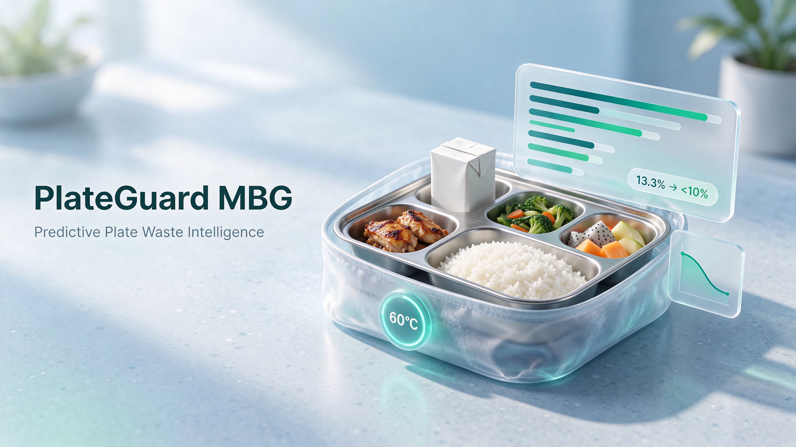
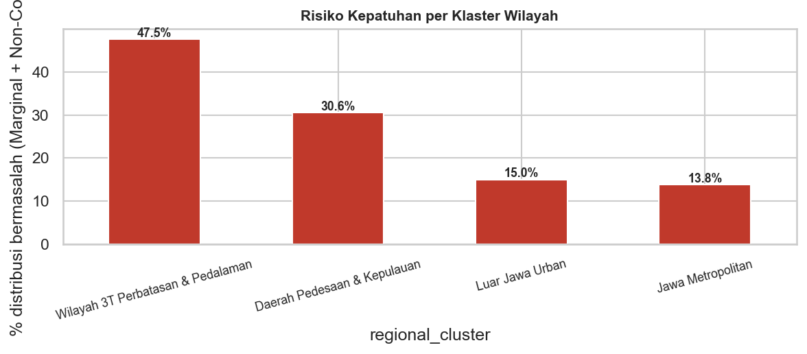
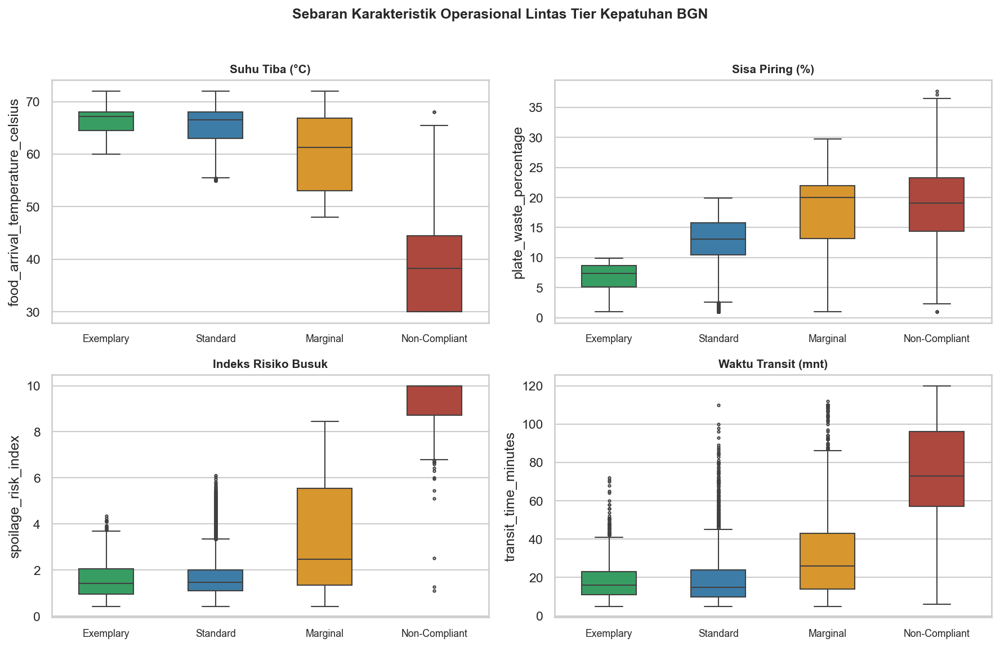
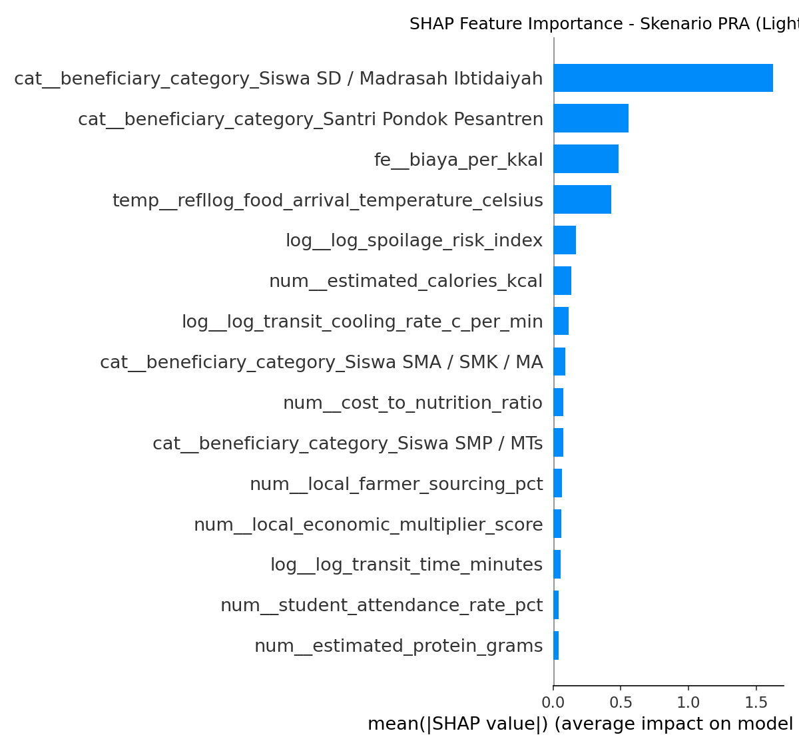
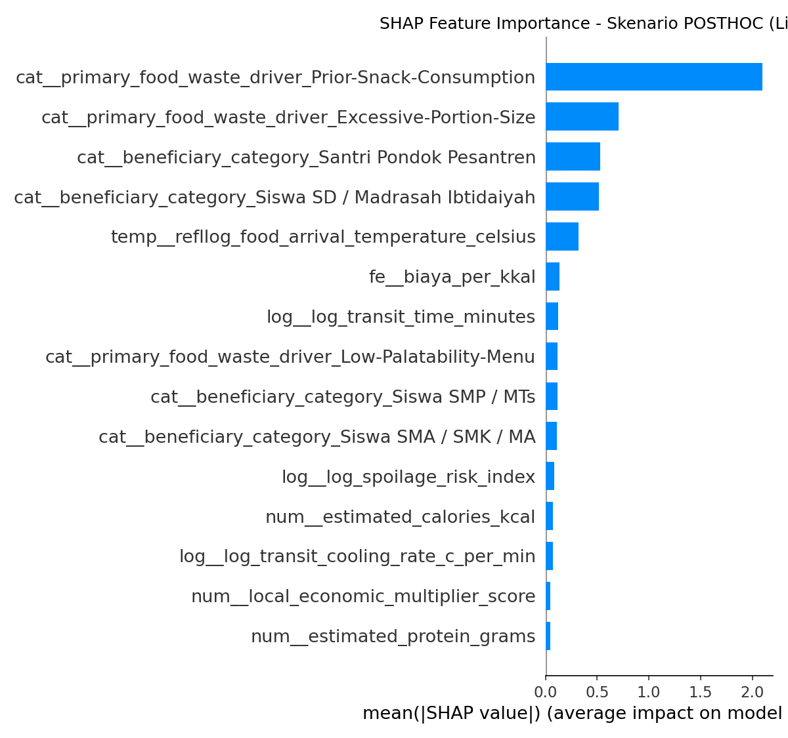

<p align="center">
  
</p>

<h1 align="center">PlateGuard MBG v2</h1>

<p align="center">
  <strong>Prediksi Sisa Makanan Distribusi Program Makan Bergizi Gratis Sebelum Armada Berangkat</strong><br/>
  <em>Gradient Boosting Regression · Audit Anti-Kebocoran Data · TreeSHAP · Penjelas Bahasa Awam · Next.js 16 + FastAPI</em>
</p>

<p align="center">
  <a href="https://modelscope.cn/studios/iqbalahdagita/plateguard-mbg"></a>
  <a href="https://nextjs.org/"></a>
  <a href="https://fastapi.tiangolo.com/"></a>
  <a href="https://lightgbm.readthedocs.io/"></a>
  <a href="https://shap.readthedocs.io/"></a>
  <a href="https://www.python.org/"></a>
  <a href="https://www.kaggle.com/datasets/luthfimuthathohirin/indonesia-makan-bergizi-gratis-mbg-telemetry"></a>
  <a href="#tim-dan-lisensi"></a>
</p>

> **Coba Aplikasi Live (Tanpa Instalasi):** Uji prediksi sisa makanan, *TreeSHAP*, penjelas Bahasa Awam, dan penjelajah 2.600 sampel holdout langsung lewat **[Plateguard MBG · Studios](https://modelscope.cn/studios/iqbalahdagita/plateguard-mbg)** di ModelScope Studios.

<p align="center">
  <a href="#ringkasan-masalah-dan-solusi">Masalah dan Solusi</a> •
  <a href="#temuan-kunci-eda-13000-distribusi">Temuan EDA</a> •
  <a href="#rekayasa-fitur-dan-guardrail-anti-leakage">Guardrail Anti-Leakage</a> •
  <a href="#hasil-benchmark-fase-3-5-fold-cv-dan-holdout-2600">Benchmark Model</a> •
  <a href="#arsitektur-aplikasi-web-v2">Web App v2</a> •
  <a href="#panduan-menjalankan-proyek">Quickstart</a>
</p>

---

## Ringkasan Masalah dan Solusi

Program **Makan Bergizi Gratis (MBG)** di bawah koordinasi Badan Gizi Nasional (BGN) menyalurkan jutaan porsi harian lewat dapur **SPPG** (*Satuan Pelayanan Pemenuhan Gizi*) di **38 provinsi**. Masalah utamanya bukan sekadar seberapa banyak kotak makan terkirim, melainkan berapa porsi yang benar-benar habis disantap penerima.

| Indikator Terukur (13.000 Catatan Nasional) | Nilai Empiris | Makna Operasional dan Anggaran |
|---|---|---|
| **Rata-rata Sisa Piring (*Plate Waste*)** | **`13,34%`** *(ekor hingga `37,7%`)* | Sekitar seperdelapan makanan bergizi terbuang di sekolah |
| **Pembengkakan Biaya Efektif** | **`Rp13.526` → `Rp15.677/porsi`** | Pemborosan **`Rp2.151/porsi` (`+15,9%`)** per kotak makan yang benar-benar termakan |
| **Risiko Wilayah 3T vs Jawa Metro** | **`47,52%` vs `13,82%`** | Wilayah 3T mencatat pengiriman bermasalah **`3,4×`** lebih tinggi *(Kalimantan Utara teratas: **`51,3%`**)* |
| **Ambang Aman Suhu Tiba (`60 °C`)** | **`63,7%` vs `12,5%`** | Paket yang tiba dingin `< 60 °C` (`22,42%` kiriman) gagal bermutu **`5,1×`** lebih sering |

Selama ini pemborosan baru tercatat **sesudah makan siang selesai** (reaktif). **PlateGuard MBG** membalik alur tersebut menjadi peringatan dini **preventif sebelum armada berangkat**:

1. **Mode Pra-Distribusi (`34` fitur):** Memakai hanya variabel yang tersedia di tahap perencanaan dapur (provinsi, klaster, jenjang penerima, lauk protein, harga porsi, kalori, estimasi jarak/durasi kirim, moda kendaraan, dan perkiraan suhu tiba) untuk koreksi menu, porsi, atau boks termal **sebelum pengiriman**.
2. **Mode Post-Hoc (`38` fitur):** Menyertakan pemicu lapangan sesudah makan (`primary_food_waste_driver`) untuk mengaudit akar penyebab pemborosan secara objektif antara tanggung jawab logistik dapur dan koordinasi kantin sekolah.

---

## Temuan Kunci EDA (`13.000` Distribusi)

Seluruh temuan berikut dihitung langsung oleh [eda_run.py](eda_run.py) dan disimpan otomatis ke [eda_results.json](eda_results.json):

- **Kelengkapan Data (`0` null, `0` duplikat):** Dataset Kaggle v4 bersih pada ke-26 kolom (total belanja porsi harian `Rp308,8 miliar`, rataan energi `677,9 kkal`, protein `22,7 g`, suhu tiba `62,9 °C`).
- **Tiga Pendorong Risiko Terkuat:**
  - **Suhu tiba dingin (`< 60 °C`):** Dari *Exemplary* menuju *Non-Compliant*, rataan suhu tiba turun drastis dan rasio bermasalah melonjak dari `12,5%` menjadi `63,7%`.
  - **Kesenjangan Geografis 3T:** Provinsi berisiko tertinggi meliputi Kalimantan Utara (`51,3%`), Papua Selatan (`46,8%`), Papua Pegunungan (`44,8%`), dan Papua Tengah (`44,0%`), berbanding terbalik dengan Banten (`16,3%`).
  - **Perilaku Jajanan dan Takaran Porsi:** `Prior-Snack-Consumption` mendominasi **`63,43%`** pemicu lapangan, disusul `Excessive-Portion-Size` (`22,40%`), `Sub-Optimal-Arrival-Temperature` (`8,58%`), `Delivery-Transit-Delay` (`4,04%`), dan `Low-Palatability-Menu` (`1,55%`).
- **Retensi Disengaja atas Pencilan (*Outliers*):** Titik ekstrem IQR seperti `spoilage_risk_index` (`11,22%` baris) dan waktu transit 120 menit pada rute 3T tetap dipertahankan penuh karena merupakan fakta logistik nyata yang paling krusial dideteksi model.

<details>
<summary><strong>Lihat Cuplikan Grafik EDA dan TreeSHAP Terverifikasi</strong></summary>

| Ketimpangan Risiko per Klaster dan Provinsi | Profil Suhu dan Pembusukan Tiap Tier |
|---|---|
|  |  |

| TreeSHAP Global — Pra-Distribusi (34 Fitur) | TreeSHAP Global — Audit Post-Hoc (38 Fitur) |
|---|---|
|  |  |

</details>

---

## Rekayasa Fitur dan Guardrail Anti-Leakage

Implementasi di [etl_pipeline.py](etl_pipeline.py) memastikan skor evaluasi bersih dari bias kebocoran target (*zero data leakage*):

1. **Pemblokiran Keras Dua Kolom Bocor (`DROP_LEAK`):**
   - `waste_adjusted_effective_cost_idr` dibuktikan identik dengan rumus aljabar `total_meal_cost_idr / (1 - plate_waste_percentage / 100)` (selisih absolut maksimum di seluruh `13.000` baris hanya **`Rp0,50`**).
   - `bgn_program_compliance_tier` diturunkan memakai ambang sisa `20%–30%` (`RandomForest` menebak kelas tier dengan akurasi **`99,7%`**, sedangkan memasukkannya ke regresi memalsukan **`R²`** ke **`0,682`**). Kedua kolom beserta artefak kurasi `confidence_score`, `cot_nutrition_logistics_rationale`, dan `distribution_id` dibuang sebelum pembagian data uji.
2. **Transformator Kustom *ReflectionLog*:** Fitur suhu tiba condong kiri (`-2,129`), dan transformasi baku `log1p` justru memburuk ke **`-2,771`**. `ReflectionLog` mempelajari $\max_{\text{train}} = 72,0^\circ\text{C}$ hanya dari data latih dan menekan kemencengan ke **`-0,087`**.
3. **Target Encoding 38 Provinsi Bebas Bocoran dan Fitur Domain:** Memakai `TargetEncoder(smooth='auto', cv=5)` ketat di dalam lipatan latih, `QuantileBinner` jarak, penskalaan `StandardScaler`, serta `FeatureBuilder` (`biaya_per_kkal`, `kecepatan_km_jam`, `interaksi_suhu_transit`).

---

## Hasil Benchmark Fase 3 (5-Fold CV dan Holdout `2.600`)

Eksperimen [train.py](train.py) dan [train-kaggle-done.ipynb](train-kaggle-done.ipynb) membandingkan **6 kandidat algoritma Charter** plus **LightGBM + Optuna TPE (30 trial × 5 fold)** pada partisi kuartil terstratifikasi `80:20` (`10.400` latih / `2.600` holdout, tercatat dalam `14` eksperimen MLflow di [models/fase3_metrics.json](models/fase3_metrics.json)).

### Skenario Pra-Distribusi (`34` Fitur — Sebelum Pengiriman)

| Model | CV 5-Fold MAE (pp) | Holdout MAE (pp) | Holdout RMSE (pp) | Holdout R² |
|---|---:|---:|---:|---:|
| **`LightGBM (Optuna)`** | **`3,604 ± 0,042`** | **`3,658`** | **`4,586`** | **`0,333`** |
| `RandomForest` | `3,636 ± 0,040` | `3,658` | `4,604` | `0,327` |
| `HistGradientBoosting` | `3,792 ± 0,036` | `3,660` | `4,592` | `0,331` |
| `LightGBM` | `3,687 ± 0,034` | `3,706` | `4,647` | `0,315` |
| `XGBoost` | `3,710 ± 0,034` | `3,712` | `4,665` | `0,309` |
| `Ridge` | `3,683 ± 0,037` | `3,720` | `4,672` | `0,307` |
| `MeanPredictor` *(Baseline)* | `4,443 ± 0,043` | `4,447` | `5,613` | `-0,000` |

### Skenario Audit Post-Hoc (`38` Fitur — Evaluasi Lapangan)

| Model | CV 5-Fold MAE (pp) | Holdout MAE (pp) | Holdout RMSE (pp) | Holdout R² |
|---|---:|---:|---:|---:|
| **`LightGBM (Optuna)`** | **`2,905 ± 0,046`** | **`2,929`** | **`3,761`** | **`0,551`** |
| `HistGradientBoosting` | `3,046 ± 0,026` | `2,940` | `3,773` | `0,548` |
| `RandomForest` | `2,943 ± 0,038` | `2,962` | `3,797` | `0,542` |
| `LightGBM` | `2,964 ± 0,032` | `2,977` | `3,819` | `0,537` |
| `XGBoost` | `2,984 ± 0,037` | `2,979` | `3,806` | `0,540` |
| `Ridge` | `2,997 ± 0,033` | `3,018` | `3,892` | `0,519` |
| `MeanPredictor` *(Baseline)* | `4,443 ± 0,043` | `4,447` | `5,613` | `-0,000` |

> **Catatan Kejujuran Ilmiah:** Pada mode **Audit Post-Hoc**, `LightGBM (Optuna)` melampaui seluruh target teknis Project Charter (`MAE 2,929 <= 3,0 pp`, `RMSE 3,761 <= 4,5 pp`, `R² 0,551 >= 0,35` — turun **`-34,1%`** galat terhadap baseline). Pada mode **Pra-Distribusi**, model memangkas galat **`-17,7%`**, sedangkan selisih `R² 0,333` terhadap `0,35` mencerminkan **batas alamiah pradistribusi** karena kebiasaan siswa jajan (`63,43%` kasus) memang belum diamati saat armada belum berangkat.

---

## Arsitektur Aplikasi Web v2

```text
  [ Next.js 16 + Tailwind v4 (Spatial Frosted Glass UI) ]
           │  Static Export (/app/static) · Sakelar Awam / Teknis
           ▼
  [ FastAPI Single Origin (api.py · Port 8000 / 7860) ]
           ├───▶ LightGBM Optuna (.joblib) + TreeSHAP Lokal Real-Time
           ├───▶ humanizer_explainer.py (apissaj/humanizer-id Bahasa Awam)
           ├───▶ Penjelajah Audit 2.600 Holdout dan Batch CSV (s.d. 100 rencana)
           └───▶ Aset Analitik dan Grafik Asli (/figures/, /figures-fase3/)
```

Empat ruang kerja interaktif di [frontend/](frontend/) dan [api.py](api.py):

1. **Simulator dan *TreeSHAP*:** Mode Pra (`34F`) dan Post-Hoc (`38F`), pembaruan slider otomatis (*debounced*), perbandingan **Patokan A vs B**, **Kurva *What-If* 9 titik** untuk suhu/kalori/durasi, kalkulator penghematan rupiah bulanan (22 hari sekolah), **Ringkasan Bahasa Sederhana (`humanizer-id`)**, serta grafik air terjun *TreeSHAP* lokal.
2. **Analitik 38 Provinsi dan *Explorer* EDA Interaktif:** Ringkasan 13.000 layanan nasional, tooltip klaster dan pemicu, **scatter interaktif 240 titik nyata** dengan garis batas `60 °C` serta tombol **`Uji Titik Ini di Simulator`**, distribusi zona suhu, peta korelasi Pearson, tab gambar asli `eda_run.py` (`10 PNG`), dan tabel interaktif 38 provinsi.
3. **Audit Model dan 2.600 Holdout:** Komparasi 7 model + stabilitas 5-fold CV, *Global TreeSHAP* interaktif, *Scatter Kalibrasi Prediksi vs Aktual*, panel transparansi `DROP_LEAK`, serta penjelajah 2.600 sampel uji dengan ekspor CSV.
4. **Batch CSV dan Swagger API:** Unggah CSV atau muat 12 jadwal simulasi, skoring serentak hingga `100` distribusi, dan dokumentasi interaktif `/docs`.

---

## Panduan Menjalankan Proyek

### 1. Lingkungan Python dan Unduh Dataset
```bash
pip install -r requirements.txt
python download_data.py
```

### 2. Reproduksi EDA, ETL, dan Pelatihan Model (Opsional — Artefak Model Sudah Tersedia)
```bash
# Fase 1: EDA -> figures/ + eda_results.json
python eda_run.py

# Fase 2: Prapemrosesan ColumnTransformer dan Guardrail Leakage
python etl_pipeline.py

# Fase 3: Training 7 model, 5-Fold CV, Optuna 30 trial, TreeSHAP, dan MLflow
python train.py --n-trials 30 --cv-folds 5
mlflow ui --backend-store-uri sqlite:///mlruns.db
```

### 3. Menjalankan Web App v2 (Next.js 16 + FastAPI)
```bash
cd frontend && npm ci && npm run build && cd ..
# Linux/macOS: rm -rf static && cp -r frontend/out static
# PowerShell : Remove-Item -Recurse -Force static -ErrorAction SilentlyContinue; Copy-Item -Recurse frontend\out static

uvicorn api:app --host localhost --port 8000
```
Buka **`http://localhost:8000/`** untuk aplikasi utama, atau **`http://localhost:8000/docs`** untuk Swagger API. *(Dasbor Streamlit v1 lawas tetap tersedia lewat `streamlit run app.py --server.port 8501`).*

### 4. Container Docker (Port `7860`)
```bash
docker build -t plateguard-mbg-v2 .
docker run -p 7860:7860 plateguard-mbg-v2
```

### Referensi Singkat Endpoint API
| Metode dan Path | Fungsi Utama |
|---|---|
| `GET /health` | Status peladen, model Pra/Post-Hoc, dan timestamp |
| `POST /predict/pra` dan `POST /predict/posthoc` | Prediksi cepat persentase sisa makanan, biaya efektif, dan kategori risiko |
| `POST /api/explain/pra` dan `POST /api/explain/posthoc` | Prediksi + kontribusi lokal *TreeSHAP* + narasi Bahasa Awam dan Teknis |
| `POST /api/what-if-curve` | Simulasi sensitivitas 9 titik untuk sumbu `temperature`, `calories`, atau `transit` |
| `POST /api/predict/batch` | Skoring serentak hingga `100` rencana distribusi |
| `GET /api/overview` dan `GET /api/eda-interactive` | Statistik agregat 38 provinsi dan data *Explorer EDA* |
| `GET /api/benchmark` dan `GET /api/holdout-samples` | Metrik 7 model + stabilitas 5-fold CV + penelusuran 2.600 baris uji |

---

## Struktur Repositori

```text
Proyek_MBG/
├── PlateGuard_MBG_cover.png          # Gambar sampul utama repositori
├── api.py                            # Peladen FastAPI v2 + serving UI statis + TreeSHAP lokal
├── humanizer_explainer.py            # Generator penjelasan Bahasa Awam (kaidah apissaj/humanizer-id)
├── etl_pipeline.py                   # Pipeline sklearn bebas leakage (ReflectionLog, FeatureBuilder, TE)
├── eda_run.py                        # Pipeline EDA terotomasi (10 figur PNG + eda_results.json)
├── train.py                          # Skrip training 7 model, 5-Fold CV, Optuna 30 trial, dan MLflow
├── build_v2_aggregates.py            # Generator agregat 38 provinsi dan tabel audit holdout
├── app.py                            # Dasbor Streamlit v1 (legacy)
├── Dockerfile & docker-compose.yml   # Multi-stage Node 20 + Python 3.12-slim (UID 1000, port 7860)
├── requirements.txt                  # Daftar dependensi Python lengkap
├── frontend/                         # Aplikasi Next.js 16 + Tailwind v4 (Spatial Frosted Glass UI)
├── data/processed/                   # Split siap latih, overview_aggregates.json, holdout_audit.csv
├── models/                           # Artefak terbaik (.joblib dan .pkl), pipeline, fase3_metrics.json
├── figures/ & figures_fase3/         # 10 grafik EDA dan 4 plot TreeSHAP
├── eda_notebook.ipynb                # Notebook EDA tereksekusi penuh
├── train-kaggle-done.ipynb           # Arsip eksekusi Kaggle (14 eksperimen MLflow dan 5-Fold CV)
└── reports/                          # Laporan Akhir IEEE (.docx) dan Naskah Presentasi 32 Slide (.md)
```

---

## Roadmap Proyek

- [x] **Fase 1:** Project Charter, audit kualitas data, penemuan kebocoran `DROP_LEAK`, serta [eda_notebook.ipynb](eda_notebook.ipynb).
- [x] **Fase 2:** Pipeline prapemrosesan [etl_pipeline.py](etl_pipeline.py) bebas kebocoran data (`ReflectionLog`, `TargetEncoder` per lipatan, split kuartil `10.400 / 2.600`).
- [x] **Fase 3:** Benchmark 7 model × 2 skenario + Optuna 30 trial + `TreeSHAP` + pelacakan MLflow ([train-kaggle-done.ipynb](train-kaggle-done.ipynb)).
- [x] **Fase 4 dan Platform v2:** Web App Next.js 16 + FastAPI + Humanizer Bahasa Awam + Explorer EDA Interaktif + Docker + Laporan IEEE dan Dek Presentasi 32 Slide ([reports/](reports/)).

---

## Tim dan Lisensi

Proyek mata kuliah **Sains Data (`PSIKS2W002`)** — Program Studi Magister Ilmu Komputer, Fakultas Ilmu Komputer, **Universitas Amikom Purwokerto** *(Dosen Pengampu: Giat Karyono, M.Kom., Ph.D.)*.

| Peran TDSP | Pelaksana |
|---|---|
| Project Lead dan Data Scientist | **Iqbal Ahdagita Elbadra** (`NIM. 26MA41D022`) |
| Data Engineer dan MLOps Engineer | **Iqbal Ahdagita Elbadra** (`NIM. 26MA41D022`) |

**Sumber Dataset:** [*Indonesia Free Nutritious Meal MBG 2026* (v4)](https://www.kaggle.com/datasets/luthfimuthathohirin/indonesia-makan-bergizi-gratis-mbg-telemetry) oleh Luthfi Muthathohirin (`13.000` distribusi × `26` kolom, agregat anonim patuh UU PDP No. 27/2022).  
**Lisensi:** Kode dirilis di bawah lisensi MIT; penggunaan dataset mengikuti ketentuan sumber pada Kaggle. Seluruh angka statistik dan evaluasi bersumber langsung dari [eda_results.json](eda_results.json) dan [models/fase3_metrics.json](models/fase3_metrics.json).
